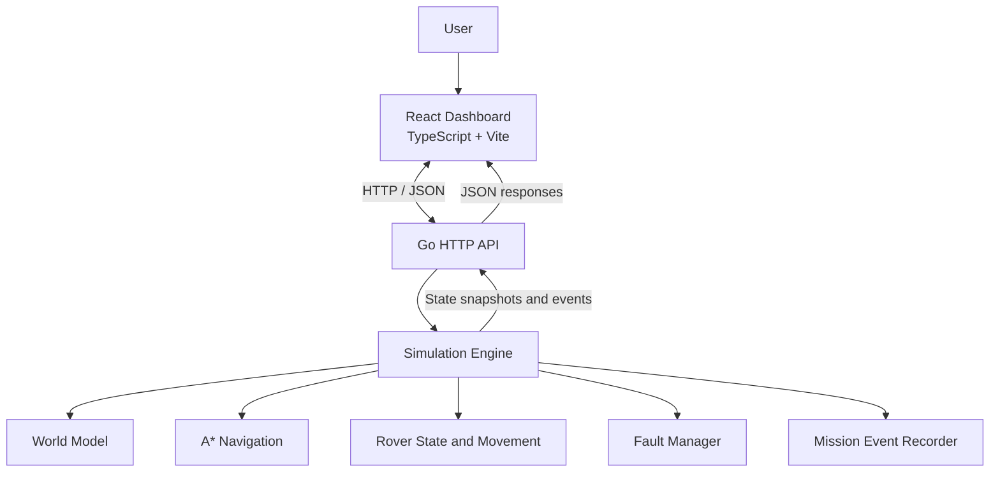
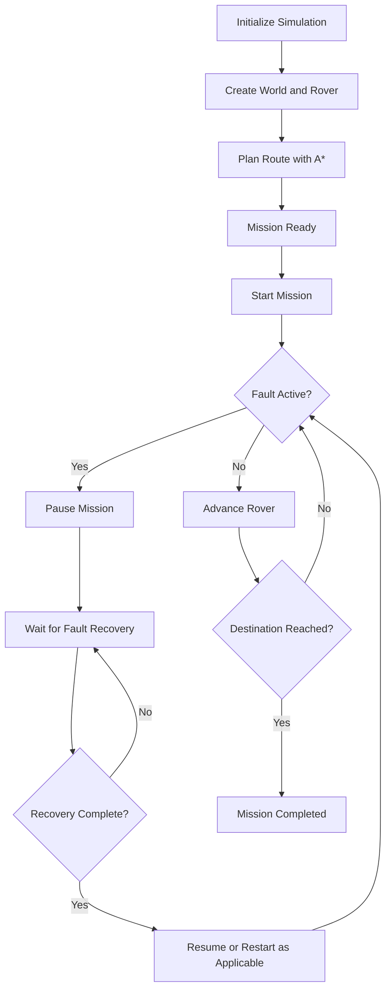

# ROVEROS — System Architecture

## 1. Purpose and Scope

ROVEROS is a software-based rover simulation and mission-control platform. It combines a Go simulation engine, an HTTP API, and a React dashboard to demonstrate grid-based navigation, mission execution, telemetry, simulated fault handling, and event observability.

This document describes the current implementation and its principal runtime interactions.

ROVEROS is a simulation environment. It is not a physical robot controller and has not been validated for safety-critical deployment.

## 2. High-Level Architecture

The system is organized into three primary layers:

1. **Presentation layer:** A React and TypeScript web dashboard.
2. **API layer:** A Go HTTP server exposing mission, state, and fault-management endpoints.
3. **Simulation layer:** Go packages implementing the world model, rover movement, navigation, mission execution, fault handling, and event recording.



The Go backend owns the simulation state. The frontend sends commands to the API and renders the resulting state rather than independently simulating rover movement.

## 3. Repository Structure

```text
ROVEROS/
├── cmd/
│   ├── roveros/
│   │   └── main.go
│   └── roveros-api/
│       └── main.go
├── internal/
│   ├── api/
│   │   ├── server.go
│   │   └── server_test.go
│   ├── fault/
│   │   └── fault.go
│   ├── mission/
│   │   ├── events.go
│   │   └── events_test.go
│   ├── navigation/
│   │   └── astar.go
│   ├── rover/
│   │   ├── rover.go
│   │   └── movement.go
│   ├── simulation/
│   │   └── engine.go
│   └── world/
│       ├── point.go
│       └── grid.go
├── web/
│   └── src/
│       ├── App.tsx
│       ├── FaultPanel.tsx
│       └── EventLog.tsx
├── README.md
└── ARCHITECTURE.md
```

The tree above highlights the principal architectural components. Additional files contain tests, frontend configuration, styling, and development tooling.

## 4. Component Responsibilities

### 4.1 World Model

**Package:** `internal/world`

Represents the grid-based environment, coordinates, and traversability constraints.

The world model provides the spatial foundation used by navigation and simulation. Obstacles are represented within the simulated environment and constrain valid routes.

### 4.2 Navigation

**Package:** `internal/navigation`

Implements A* pathfinding to plan a route between the rover's starting position and its destination.

The navigation layer works with the world model to identify a route that avoids blocked cells. The resulting path is used by the simulation engine during mission execution.

### 4.3 Rover Model

**Package:** `internal/rover`

Represents rover state and movement within the grid.

This component handles position changes and movement-related state. The simulation engine coordinates those operations with mission progress and telemetry updates.

### 4.4 Simulation Engine

**Package:** `internal/simulation`

Coordinates the main simulation lifecycle.

Its responsibilities include:

- Initializing the world and rover.
- Preparing the navigation route.
- Starting, pausing, resuming, and resetting missions.
- Advancing mission execution.
- Updating simulated battery usage and progress.
- Coordinating fault handling.
- Recording mission events.
- Producing state snapshots for the API.

The engine is the central coordination component. The HTTP handlers expose its operations to external clients.

### 4.5 Fault Management

**Package:** `internal/fault`

Tracks simulated faults, active fault conditions, and fault history.

Fault injection and recovery are explicit operations. Recovering a fault removes the active condition while preserving its historical record.

The simulation engine integrates fault state with mission execution so that a supported sensor failure can pause a running mission.

### 4.6 Mission Event Recorder

**Package:** `internal/mission`

Defines mission events and maintains the bounded event history.

Recorded event categories include mission lifecycle transitions, rover movement, and fault injection or recovery.

The current implementation retains up to 500 events in memory and removes older entries when the limit is exceeded. Event identifiers increase monotonically during the recorder's lifetime, and event timestamps use UTC.

The event history is not currently persisted to a database or file. It is lost when the backend process restarts.

### 4.7 HTTP API

**Package:** `internal/api`

Provides HTTP endpoints for reading simulation state and issuing mission and fault-management commands.

The API forms the boundary between the web application and the Go simulation engine. It is responsible for handling HTTP requests and returning responses to the client.

### 4.8 Web Dashboard

**Directory:** `web/src`

The dashboard is built with React and TypeScript.

- `App.tsx` manages the main mission-control interface and communicates with the Go API.
- `FaultPanel.tsx` provides the simulated fault injection and recovery controls.
- `EventLog.tsx` presents recent mission events.

The dashboard visualizes backend state, including rover position, progress, battery level, mission status, faults, and recent events.

## 5. Runtime Topology

During local development, the application runs as two separate processes.

| Component | Default address |
|---|---|
| Go HTTP API | `http://127.0.0.1:8081` |
| Vite development server | `http://localhost:5173` |

The backend API listens on the configured local address and port. The frontend communicates with the backend over HTTP.

The API's development CORS configuration permits the local frontend origins:

- `http://localhost:5173`
- `http://127.0.0.1:5173`

These settings support local development; they are not a production deployment configuration.

## 6. Mission Execution Flow

The default scenario initializes a 20 × 10 grid with a rover starting at `(1, 1)` and a destination at `(15, 7)`.

The current environment contains a central wall and additional blocked cells. A* computes a route through traversable cells.

The mission follows this general sequence:



At each simulation step, the engine advances the rover along the planned route, updates mission state, and records relevant events.

In the verified default scenario, the rover completed a 22-move mission and finished with 78% simulated battery remaining.

These values describe the current scenario, not real-world robot performance.

## 7. State and Telemetry Flow

The dashboard retrieves a simulation snapshot through `GET /api/state`.

The snapshot provides the frontend with the current mission state and relevant simulation information, including the rover's position, mission progress, battery status, and recorded events.

While a mission is running, the frontend requests simulation steps at approximately 450-millisecond intervals. The resulting state is refreshed and rendered in the dashboard.

The fault panel also refreshes state periodically, at approximately one-second intervals.

This is a local simulation and polling-based update model. It does not use a physical telemetry connection, hardware sensor feed, or a streaming protocol such as WebSocket.

## 8. Fault Injection and Recovery Flow

The fault-handling workflow is designed to make failure behavior observable and testable.

1. The user selects a supported component in the fault panel.
2. The frontend submits a fault-injection request.
3. The Go API forwards the request to the backend fault-handling logic.
4. When the supported navigation sensor fault is injected during mission execution, the simulation enters a paused state.
5. The engine records the relevant fault and mission events.
6. The user requests fault recovery.
7. The active fault is cleared while its historical record is retained.
8. Mission execution can continue after the fault has been recovered and the mission is resumed as appropriate.

The distinction between active faults and fault history is intentional: resolving a fault should not erase evidence that it occurred.

**Safety limitation:** this behavior is implemented within a software simulation. It does not establish the safety of a physical rover or a real sensor subsystem.

## 9. Mission Event Log

The event recorder provides a chronological history of relevant simulation operations.

Examples include:

- Mission initialization and route planning.
- Mission start, pause, resume, and completion.
- Rover movement.
- Sensor fault injection and recovery.

Events are included in simulation snapshots and displayed by the dashboard. The event-log interface shows the most recent 20 events, while the backend recorder maintains a history of up to 500 events.

The current event log is an in-memory diagnostic facility, not a durable audit trail. Process restarts remove the recorded history.

## 10. HTTP API

The current API exposes these endpoints:

| Method | Endpoint | Responsibility |
|---|---|---|
| `GET` | `/api/health` | API health check |
| `GET` | `/api/state` | Retrieve a simulation snapshot |
| `POST` | `/api/mission/start` | Start mission execution |
| `POST` | `/api/mission/step` | Advance the simulation |
| `POST` | `/api/mission/pause` | Pause mission execution |
| `POST` | `/api/mission/resume` | Resume mission execution |
| `POST` | `/api/mission/reset` | Reset the simulation |
| `POST` | `/api/faults/inject` | Inject a supported simulated fault |
| `POST` | `/api/faults/recover` | Recover a simulated fault |

A fault request uses a component identifier in its JSON payload. For example:

```json
{
  "component": "navigation_sensor"
}
```

Request and response details should be verified against the current handlers in `internal/api` when developing additional clients.

## 11. Testing Strategy

The project contains Go unit tests for its core packages and API behavior, along with frontend linting and production-build checks.

### Backend

Run the Go tests from the repository root:

```bash
go test ./cmd/... ./internal/...
```

The current test suite covers components such as the world model, rover, navigation, simulation engine, fault manager, mission events, and API.

### Frontend

Run the following commands from the `web` directory:

```bash
npm run lint
npm run build
```

The lint command checks frontend code quality. The production build validates TypeScript compilation and produces the optimized frontend assets.

Passing automated tests does not replace end-to-end testing or validation against physical hardware.

## 12. Current Limitations

The current architecture has several deliberate limitations:

- The environment and rover are simulated rather than connected to physical hardware.
- The mission event history is held in memory and is not durable across backend restarts.
- State refresh and mission stepping rely on HTTP requests and polling.
- The development setup uses local addresses and development-oriented CORS settings.
- The current project has not been validated for real-time, distributed, or safety-critical operation.
- The dashboard is a development interface rather than a hardened production control station.

These boundaries define the current scope and help distinguish implemented functionality from future extensions.

## 13. Potential Architectural Extensions

Future work could introduce:

- Persistent mission history and exportable investigation reports.
- Configurable worlds and reusable mission scenarios.
- Additional fault models and recovery policies.
- API integration tests covering complete mission lifecycles.
- Streaming updates for larger or more demanding simulations.
- Structured configuration and deployment profiles.
- A hardware abstraction layer for a separately engineered physical integration.

Any physical deployment would require additional engineering, hardware-specific testing, and an independent safety assessment.
